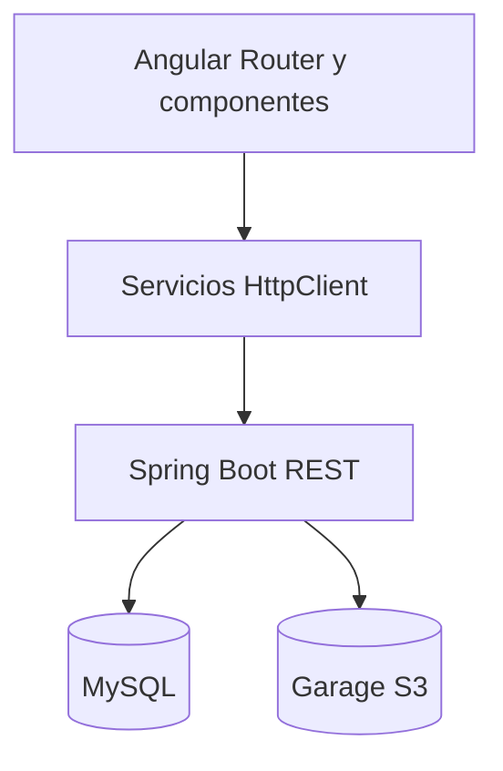

# Implementación técnica T2

Esta rama contiene las pantallas y la integración que permiten demostrar el flujo web de la T2. El informe académico y las capturas de ejecución se entregan por separado.

## Navegación

| Ruta Angular | Rol | Operación visible |
|---|---|---|
| `/login` y `/registro` | Público | Inicio de sesión y registro de adoptante/organización |
| `/admin` | ADMIN | Consultar organizaciones, activar/desactivar y editar datos |
| `/organizacion` | ORGANIZACION | Listar publicaciones propias y eliminar |
| `/organizacion/publicar` | ORGANIZACION | Publicar con datos y 2–8 fotos |
| `/organizacion/mascotas/:id/editar` | ORGANIZACION | Editar datos y estado de una publicación propia |
| `/adoptante` y `/adoptante/mascotas/:id` | ADOPTANTE | Catálogo de disponibles y detalle |

Las rutas están protegidas por rol. La sesión se guarda en `sessionStorage` durante la vida de la pestaña y se borra al cerrar sesión. Las solicitudes a la API incluyen JWT en `Authorization`.

## Relación frontend y API

- Usuarios: registro e inicio de sesión (`/auth/*`).
- Organizaciones: registro de perfil por cuenta, consulta y edición de datos, activación administrativa.
- Mascotas: creación con fotos, consulta pública para usuarios autenticados, edición y eliminación desde el panel de organización. `GET /animales/mios` solo devuelve las publicaciones de la organización autenticada.
- Fotos: Garage almacena archivos; MySQL conserva claves y metadatos. La eliminación de una mascota borra sus metadatos y, tras confirmar la transacción, intenta retirar sus objetos de Garage.
- Bootstrap 5 se carga en `angular.json`; se usan botones, tarjetas y alertas del framework con estilos propios del proyecto.

## Evidencia para el informe

Captura con cuentas de prueba, sin mostrar contraseñas ni tokens: registro, login, panel admin con edición/activación, panel de organización con listado, publicación con dos fotos, edición, eliminación confirmada, catálogo y detalle del adoptante. Incluye una captura de la pestaña Network que muestre códigos `200`, `201`, `204` según la operación. Explica qué operaciones cambian MySQL y Garage. Añade el diagrama ER, el vínculo con ODS 9, los requisitos funcionales actualizados, modelo de negocio, al menos cinco conclusiones y referencias APA según las instrucciones de T2.

## Verificación pendiente en el miniserver

1. Ejecutar `./mvnw -DskipTests compile` con acceso a Maven Central o dependencias en caché.
2. Arrancar Spring con las variables de Garage cargadas y probar con cuentas ADMIN, ORGANIZACION activa y ADOPTANTE.
3. Verificar que `GET /animales/mios` solo liste mascotas propias; que `PUT` y `DELETE` rechacen mascotas ajenas; y que la eliminación retire fotos en Cyberduck.
4. Reconstruir Angular con `npm ci && npm run build` y comprobar las rutas detrás de `hc.itechk.us` al refrescar.
